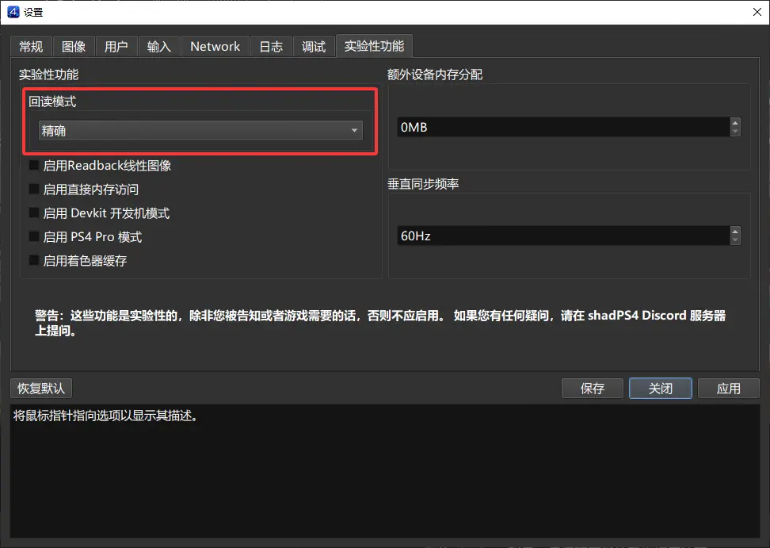

<!--
SPDX-FileCopyrightText: 2026 shadPS4 Emulator Project
SPDX-FileCopyrightText: 2026 Serina765P
SPDX-License-Identifier: GPL-2.0-or-later
-->

# shadPS4-imas

> [!CAUTION]
> **重要声明**：本仓库**完全由 AI 开发维护**，代码质量无法保证。所有修改仅在本仓库内更新，**不会提交到上游主线**。
> 
> - 出现问题可以提 Issue，但无法保证修复的正确性
> - 建议用户根据自身需求选择下载使用
> - 如需稳定体验，请使用 [shadPS4 官方版本](https://github.com/shadps4-emu/shadPS4)

本仓库是基于 PlayStation 4 模拟器 [shadPS4](https://github.com/shadps4-emu/shadPS4) 以及原 fork 作者 **水年沐华**（[Nyces / Muhua](https://github.com/Nyces)）针对《偶像大师》系列优化分支的**二次修改版本**。

---

## 🎮 支持的游戏与运行现状

本版本（及 [Nyces/shadPS4](https://github.com/Nyces/shadPS4) ）主要针对 PS4 平台上的两款《偶像大师》正作进行专项适配：

| 游戏名称 | 日版 ID | 繁中版 ID | 运行状态 |
| :--- | :--- | :--- | :--- |
| **《偶像大师 白金星光》** (THE IDOLM@STER: Platinum Stars) | `CUSA03628` | `CUSA05706` | **✅ 基本可玩 (Playable)** |
| **《偶像大师 星光舞台》** (THE IDOLM@STER: Stella Stage) | `CUSA07753` | `CUSA09153` | **✅ 基本可玩 (Playable)** |

> [!WARNING]
> 本分支包含大量针对偶像大师游戏特化的图形着色器与音频管线补丁，**可能无法正常运行其他通用 PS4 游戏**。如需游玩其他游戏，建议使用 shadPS4 官方主线版本。

---

## ⚙️ 关键使用方法与配置建议（必读）

为了获得稳定、正常的游玩体验，请务必注意以下设置：

1. **图形设置：必须开启"精确回读"（Precise Readback）**
   - 在配套启动器（如 QtLauncher）游戏特殊设置——实验性功能中，将 **Readback mode（回读模式）** 设置为 **`Precise`（精确）**。
   - **原因**：若未开启回读，长时间游玩或特定场景下可能会偶发模型顶点拉伸（如人物模型撕裂）或贴图错乱。  

   
  
2. **纯手柄游玩体验**
   - 本二次修改版已彻底消除离线游玩时的阻塞弹窗（目前我看到的都处理了），连接手柄后应该可全程脱离鼠标使用。
3. **必要系统固件（sys_modules）**
   - 模拟器正常运行依赖从正版 PS4 导出的固件模块。请将以下常见关键模块置于模拟器的 `sys_modules/` 目录下（如 `libSceAudiodec.sprx`、`libSceFont.sprx`、`libSceJob.sprx` 等）。
   - 模拟器系统固件请自行查找或从实机获取。

---

## 🚀 下载与使用

请前往本仓库的 [Releases 页面](https://github.com/Serina765P/shadPS4-imas/releases) 下载最新的构建版本：

- **Windows 用户**：下载 `shadps4-idolmaster-windows-x64-*.zip`，解压后搭配 [QtLauncher](https://github.com/shadps4-emu/shadps4-qtlauncher/releases) 启动，或直接运行 `shadPS4.exe` 引导游戏。
- **Linux 用户**：下载 `shadps4-idolmaster-linux-x64-*.tar.gz` 解压使用。

具体修改内容请查看各版本的 Release 说明。

---

## 🤝 致谢与原作者联系方式

- 感谢 [shadPS4](https://github.com/shadps4-emu/shadPS4) 官方团队及全体开源贡献者。
- 感谢原 fork 作者 **水年沐华**（Nyces）的反复测试、日志诊断与代码贡献！
  - Bilibili：[https://space.bilibili.com/3461562899630581](https://space.bilibili.com/3461562899630581)
  - Telegram：[https://t.me/nny_mhua](https://t.me/nny_mhua)
